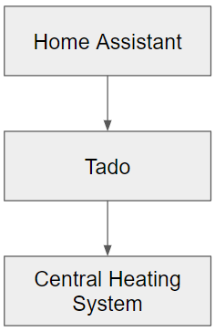
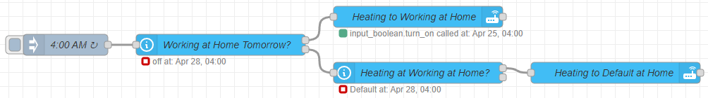
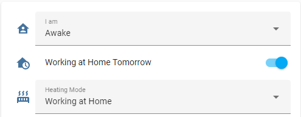
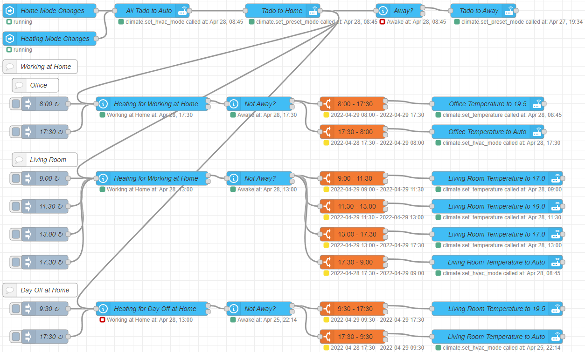

## Introduction

This article showcases a way to implement multiple Tado schedules using Home Assistant and Node-RED. Allowing Home Assistant beginners to quickly and easily write more advanced schedules for their Tado thermostat system.

## Background

Last winter, I decided to invest in the smart thermostat system from Tado. It consists of a central thermostat complimented with smart radiator knobs that have to be installed in every room you want to smartly control. Every knob communicates its temperature with the central thermostat, allowing the system to close knobs in rooms that are warm enough, while opening knobs and still requesting heat from the central heating system for rooms that need to be heated.

Tado allows the user to configure a schedule daily for every individual room. Something I could use to specifically heat my office on days I was working at home, while not wasting energy on my living room at the same time. This worked great!

However, I wouldn't be writing this post if there weren't limitations to the system. My first annoyance actually came during a couple of days I had planned off during the Christmas period. Using my old thermostat, I could simply mark one or more upcoming days as free days, in which case it would execute the schedule as defined for Sundays. Tado did not have this option, forcing me to manually change two schedules for that week: turning the heating on in the living room and disabling the office heating on days I usually worked at home.

A second problem became apparent when I started working more and more in the office on variable days. Even though the Tado system does have an "away" option, this would not prevent my office from being preheated just before I left my home, thus wasting energy.

These "limitations" to an otherwise great system were the biggest factors that moved me towards using Home Assistant. I wanted to control Tado using Home Assistant, while the central heating system would still be controlled by Tado:

Surprisingly, I found little to nothing on Home Assistant users that successfully integrated their Tado systems. There were some tips and tricks provided here and there, but no one seemed to have written an actual usable tutorial or template on how to configure additional schedules on one of the most popular home automation platforms of the time.

As awareness of energy usage is becoming an ever more important subject, I decided to share my own solution to these problems.

## Design

Before starting on the design of this implementation, there were two main principles I kept in the back of my mind:

### Simplicity

This is probably the most important principle I keep in mind while automating anything. Automations should be simple to understand, both by me and other people that might end up using them. On top of that, I want them to be user friendly. There should never be a "please don't touch that button" moment in my house. Automations are here to support users, not limit them.

### Redundancy

Before starting this Home Assistant automation, I had a working system. Even though it was limited, it worked and improved my comfort. By adding another component, I do not want to become more dependent on it. Even if my Home Assistant server stops working for any reason, I do not want to lose the comfort I had to begin with.

With all that being said, let's get started!

The first thing I needed to think about was how I would activate certain heating modes. As I had already implemented a "**Home Mode**" with the states "**Awake**", "**Asleep**" and "**Away**", I considered adding it here. However, heating would have to operate independently of the state of the occupant(s). For example, preheating the office would already need to kick in before I was waking up. And adding an "**Asleep (working at home tomorrow)**" felt a bit convoluted.

For that reason, I decided to add a new parameter. As I would only use it for heating at this point, I simply called it "**Heating Mode**" (after all, future refactoring is always possible if I want to extend the usage of this parameter). This immediately felt right, as I could not only add the "**Working at Home Tomorrow**" state, but also use it for "**Day Off at Home**" which will then copy Sunday's schedule. The state "**Default**" was added to tell my system it should simply use the schedule that was configured in Tado itself (e.g., Auto mode on all knobs).

In order to make the decision of working at home a flexible one, I decided to add a toggle allowing me to specify that I will be working at home tomorrow. This allows me to make the decision the day prior, and also makes sure the correct heating mode is already on when I am still sleeping, allowing it to preheat the office. The implementation of this boolean is as follows:

Every day at 4:00 AM, the system will check whether or not I am working at home tomorrow. In case this is not happening, it only sets the heating to "**Default**" if it was in "**Working at Home**", preventing it from disabling the "**Day Off at Home**" mode when I am enjoying some time off.

After going though this flow, it will automatically set the "**Working at Home Tomorrow**" toggle to a state according to a most likely schedule (not shown here), but if I decide to deviate, I can simply change the toggle in the user interface.

As for the user interface, it is (still) very straightforward. For now, this is everything I am able to toggle:

Even though all three properties are toggled automatically, it is never a problem for me to manually change something in there.

## Tado Configuration

For the Tado configuration, I choose to set it up in a way I would use the house when going to work full time. This means that on weekends, it would warm the living room, while on weekdays, it wouldn't heat anything until around 17:30, at which time the living room would be heated.

The reason I choose this, is that in case my Home Assistant would be down, there would be as little chance of wasted energy as possible. And in case it would happen when I actually do need to be at home, I can manually correct the heating (and hopefully fix my Home Assistant server).

Of course this is just my preference. You can setup your Tado anyway you'd like, just see this as the "**Default**" while using Home Assistant to overwrite at the moments you need it to.

## Node-RED Implementation

Now that the Tado system is configured, we need to be able to overwrite the default schedule using Home Assistant. For this, I am using the plug-in Node-RED for easy visualization. My implementation is as follows:

For the implementation, I wanted to be able to set specific temperatures at specific times. But it was also an important consideration that these schedule blocks could be triggered at any time when either the heating mode or the home mode would change. To achieve this, I decided to work with "*time range*" blocks (the orange ones). Triggering anything at the start of the flow, would always result in the correct Tado state in every room.

When either the home or the heating mode changes, I simply reset the entire state of the Tado system to Auto and Home before overwriting them with the appropriate settings depending on the actual state of the home and the time of day.

Finally, at the start time of each schedule block, I used "*inject*" blocks (the gray ones on the left) to trigger the corresponding logic as well. This is also the part I like the least about this implementation: it means that I have to update at least two blocks every time I want to change the schedule. I did not think of an easy way around this problem, other than implementing a custom block that can be used as both a range and a trigger. Using variables would also not help much, as it would still require additional work if the amount of schedule blocks changes.

### Home Assistant Services

If you would like to make your own automation in Home Assistant using Tado, there were only four services I required. Here they are for your convenience:

| Action | Domain | Service | JSONata |
| --- | --- | --- | --- |
| Set Tado to Home | `climate` | `set_preset_mode` | `{"preset_mode":"home"}` |
| Set Tado to Away | `climate` | `set_preset_mode` | `{"preset_mode":"away"}` |
| Set specific temperature | `climate` | `set_temperature` | `{"temperature":"19.5"}` |
| Set temperature to auto  
(use Tado schedule) | `climate` | `set_hvac_mode` | `{"hvac_mode":"auto"}` |

## Points of Interest

-   As with any implementation, it is important to think about the usage and design before diving into the logic. But even including that, this didn't take more than two hours to implement.
-   When I created this implementation, I was only using Home Assistant and Node-RED for less than a week. If you have any useful tips or improvements, don't hesitate to leave a comment.
-   Even though Node-RED is great for simple implementations, it also has some clear limitations. It helped me setup a few quick implementations, but more likely than not, I will eventually move to using a custom application that communicates with Home Assistant via its REST API.
-   By using the standard Tado integration from Home Assistant, you are reliant on an internet connection. This shouldn't be a problem as this implementation is redundant, however, I might look into an implementation that communicates with Tado locally in the future.

## History

-   ##### 18th May, 2022 - Version 1
    
    -   Initial version
-   ##### 19th May, 2022 - Version 1.1
    
    -   Added Point of interest on internet requirement of this implementation
