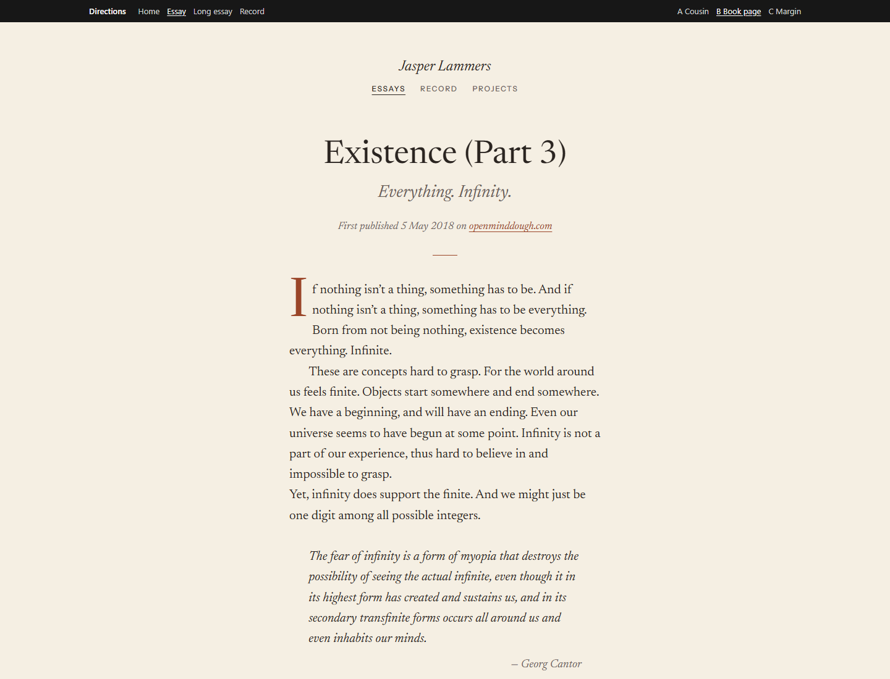

# Direction B: Book page

Archived 2026-10-26. Original routes: `/directions/b/` (home), `/directions/b/essays/<slug>/` (every essay), `/directions/b/record/`. Working state: tag `design-directions-v1`.

Also: `screenshot-essay-375.png`, `screenshot-home-1440.png`, `screenshot-home-375.png`.

## Mood
A well-set printed essay: the most bookish of the three. Everything centred in a narrow column, cream paper, a rust accent used sparingly.

## Fonts
- Titles and reading: Newsreader Variable with optical sizes. Package: `@fontsource-variable/newsreader` (`opsz.css`, `opsz-italic.css`).
- Small labels (nav, series heading, footer): Instrument Sans Variable, uppercase with wide tracking. Package: `@fontsource-variable/instrument-sans`.
- Both packages were uninstalled when B was archived.

## Colour tokens
| Token | Light | Dark |
| --- | --- | --- |
| paper (cream) | `#F5EFE3` | `#1E1A17` |
| ink | `#2A2420` | `#E9E1D3` |
| muted | `#6B6158` | `#ABA190` |
| accent (rust) | `#9A4528` | `#E39A78` |
| rule | `#DDD3C2` | `#3A332D` |
| tint | `#EEE6D6` | `#27221E` |

All text pairings pass WCAG AA (ink 13.4, muted 5.3, accent 5.6 on light paper).

## Layout
- Centred header: the name in Newsreader italic, nav below in small caps.
- Essay: the title split for display into "Existence (Part 3)" and an italic subtitle "Everything. Infinity."; provenance line in italic; a short accent rule; body at 1.3rem with line height 1.6 in a 34rem column; a rust drop cap; book-style paragraphs (indented, no gap); italic quotes with a right-aligned attribution; centred italic essay headings.
- Home: a small round photo, a large Newsreader greeting, the hiring line between two hairlines, links as a small-caps row.
- Record: a centred list with dotted leaders between the title and an italic date.

## What we liked
Claude's assessment (your own reasons were not recorded): the strongest pure reading experience; the drop cap and indented paragraphs feel like a book; the title split makes the Existence series read well.

## Why it wasn't chosen
A was chosen. Claude's assessment: B has no visual link to devjasper.nl, while the brief asks for cousins; its literary tone leans towards "serious intellectual" over the brief's warmth; and indented paragraphs fight the essays' many hard line breaks.

## Files
`src/components/directions/b/*` (LayoutB, HomeB, EssayB, RecordB) and `src/styles/directions/b.css`. It also depends on shared files that stayed in the project: `src/pages/directions/[dir]/*` (dynamic routes), `src/components/directions/registry.ts`, `directions.ts` and `DirectionsBar.astro`, `src/lib/essays.ts`, `src/lib/record.ts`, `src/data/site.ts`, `src/layouts/BaseLayout.astro`, `src/assets/jasper.png`. These are temporary and may be gone after the real build; the tag has them all.
