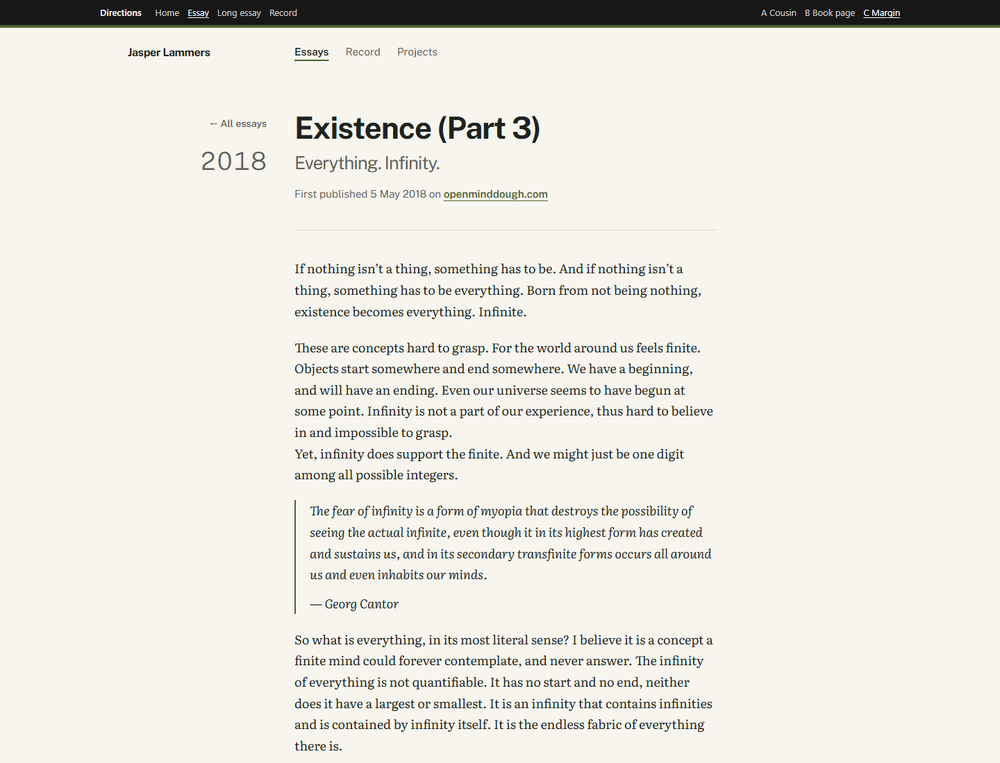

# Direction C: Margin

Archived 2026-10-26. Original routes: `/directions/c/` (home), `/directions/c/essays/<slug>/` (every essay), `/directions/c/record/`. Working state: tag `design-directions-v1`.

Also: `screenshot-essay-375.png`, `screenshot-home-1440.png`, `screenshot-home-375.png`.

## Mood
An organised notebook that leans on the brief's "dated evidence": left-aligned, a margin column for labels and dates, a moss accent and a thin accent rule along the top of the page.

## Fonts
- Headings and interface: Public Sans Variable. Package: `@fontsource-variable/public-sans`.
- Reading: Literata Variable with optical sizes. Package: `@fontsource-variable/literata` (`opsz.css`, `opsz-italic.css`).
- Both packages were uninstalled when C was archived.

## Colour tokens
| Token | Light | Dark |
| --- | --- | --- |
| paper | `#F7F5EE` | `#191B18` |
| ink | `#1F2320` | `#E4E4DA` |
| muted | `#5E625A` | `#A3A699` |
| accent (moss) | `#4C6130` | `#A9C27E` |
| rule | `#DCDACE` | `#34372F` |
| tint | `#EEEBE0` | `#22251F` |

All text pairings pass WCAG AA (ink 14.6, muted 5.7, accent 6.3 on light paper).

## Layout
- A 12.5rem margin column and a 38rem text column from `lg` (1024px); on phones the margin content folds above the text.
- Essay: "← All essays" and the year in the margin; the title with its subtitle on a second line in muted; body Literata at 1.125rem with line height 1.7; essay headings hang in the margin, right-aligned and level with the paragraph they introduce; quotes with a 2px accent left rule; footnotes in Public Sans.
- Home: a small square photo in the margin; the copy as a few short lines; the hiring line between hairlines; Essays, Record and Projects as a ruled list with arrows (Sivers style).
- Record: group labels in the margin, rows with the title on the left and the date on the right between hairlines (Chimero style).

## What we liked
Claude's assessment (your own reasons were not recorded): the hanging headings make the long essays easy to scan, and `/record` reads best as a dated list in this layout.

## Why it wasn't chosen
A was chosen. Claude's assessment: C shares nothing visual with devjasper.nl, while the brief asks for cousins, and its structured, document-like feel is cooler than the brief's "warmth and friendliness". Its `/record` treatment could still be borrowed.

## Files
`src/components/directions/c/*` (LayoutC, HomeC, EssayC, RecordC) and `src/styles/directions/c.css`. It also depends on shared files that stayed in the project: `src/pages/directions/[dir]/*` (dynamic routes), `src/components/directions/registry.ts`, `directions.ts` and `DirectionsBar.astro`, `src/lib/essays.ts`, `src/lib/record.ts`, `src/data/site.ts`, `src/layouts/BaseLayout.astro`, `src/assets/jasper.png`. These are temporary and may be gone after the real build; the tag has them all.
