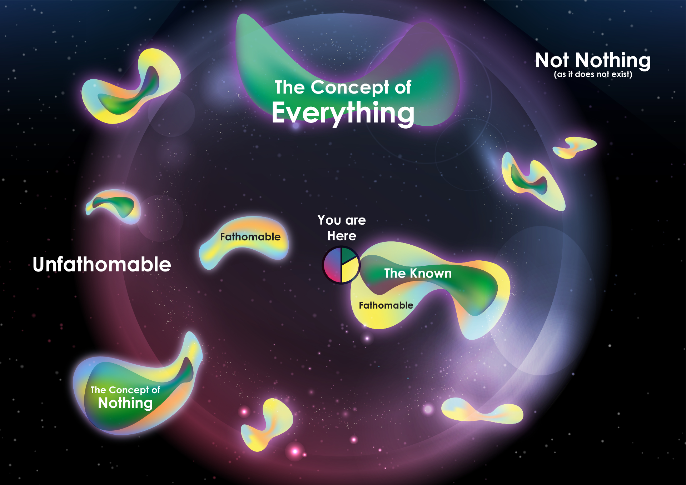

Existence is not the chair you sit in nor the air you breathe. It is not the molecules that build you, the space you move through or the time that ages you. Everything we know is but one entity in the ocean we would call existence.

I’ve often thought about the nature of existence, reality itself. Even though many have passed my mind, there is one idea in particular that I would like to share.

When contemplating existence it is tempting to start with our own reference frame. The dimensions we live in, the things we think to understand. We exist in spatial dimensions, does everything exist in spatial dimensions? If space has an end, what is beyond? And how about time, does it have a start and end?

This way of thinking about existence might be of practical use, as we explore our own little shell of “local” existence. But it will never bring us closer to what real existence is. For molecules might be formed from atoms and atoms from quarks, but what lies beyond? Even if our dimensions are quantized and we get to the bottom. What would we really have learned about existence itself?

To truly get a fresh perspective, one should look beyond the world we live in. Not into existence we are used to, but into the existence that may lie beyond. Forever unreachable by our instruments and senses. Possibly only ever attainable by our imagination.

If our reality allows for the secret of existence to be discovered, I believe it to be there. For the quest for existence, is a quest of the mind.

## Nothing

So. Where might one begin, if it is not our own frame of reference? Without our perspective we have no matter to analyse, no space to start in and not even a beginning as there is no time. We start out with nothing.  
How about we do? Literally start with nothing.

Out of the ideas I wish to explain, this one might be the hardest to put into words. To some, this would seem like twisting definition. A play of words. But allow yourself to be open to what nothing really would mean. Don’t try to understand it so much, as to feel it.

Nothing. While the definition is simple, the concept is often interpreted as the absence of something.  
We imagine the absence of matter. Is this nothing?  
We imagine the absence of radiation. Is this nothing?  
We imagine the absence of dimensions. Is this nothing?

When we ask ourselves why anything exists, we are not asking why there is not just empty space, or some quantum soup. We are asking ourselves why anything, anything at all exists. Why is there not just nothing? Pure, unconditional nothing?

Only when we leave our own perspective behind can “nothing” take its true form, its true meaning. Nothing as nothing. A definition not open for debate.

This is the point where our way of thinking abandons us. For nothing is a concept that cannot even be conceived by our imagination. The reason for this, I believe, is that nothing in reality is as true as its definition on paper: nothing is not a thing.

Nothing. A concept to represent the opposite of something. For in our world, up must have a down and full must have an empty. Something… must have nothing.

Only in the absence of anything, there would be nothing. But in a pure and naked existence, why would there be a preference for one or the other?  
Consider the following.  
If there is nothing, there is nothing to prevent something to be.  
If there is something, this is everything to prevent nothing to be.

Of course, the concept of nothing can never fully be grasped, and this is just my take on it. But to me, nothing, when taken in the truest meaning of the word, is not a thing.

Therefore, there is something.

## Everything

If nothing isn’t a thing, something has to be. And if nothing isn’t a thing, something has to be everything. Born from not being nothing, existence becomes everything. Infinite.

These are concepts hard to grasp. For the world around us feels finite. Objects start somewhere and end somewhere. We have a beginning, and will have an ending. Even our universe seems to have begun at some point. Infinity is not a part of our experience, thus hard to believe in and impossible to grasp.  
Yet, infinity does support the finite. And we might just be one digit among all possible integers.

> The fear of infinity is a form of myopia that destroys the possibility of seeing the actual infinite, even though it in its highest form has created and sustains us, and in its secondary transfinite forms occurs all around us and even inhabits our minds.
> 
> — *Georg Cantor*

So what is everything, in its most literal sense? I believe it is a concept a finite mind could forever contemplate, and never answer. The infinity of everything is not quantifiable. It has no start and no end, neither does it have a largest or smallest. It is an infinity that contains infinities and is contained by infinity itself. It is the endless fabric of everything there is.

If I were to describe it, more than anything else, I believe existence. Everything. Is potential. The potential for everything to exist and everything to be. A potential that is fact. Endless potential for our and countless other realities to exist.

Everything is because nothing is not. Endless realities being just one of the many effects of existence itself.

### The Fathomable

The thing with everything, is that all we can imagine about it, is true. But everything we cannot imagine about it, is also true.

Our ability to reason, think and contemplate is just one of our senses. And like all others, it is a sense bound to our local reality, and therefore limited by it. As our eyes observe light, our mind observes the fathomable.

And for all beauty our other senses could ever make us feel, the fathomable has the potential to be more beautiful still. For the fathomable is not bound to our reality and can give us a glimpse of what might lie beyond. This is the reason existence can only be explored by the mind. This is the reason we should want to explore with the mind.

I believe our perception of the fathomable can grow as we grow. But as we are bound to our senses and eventually by our reality, the fathomable will also be bound. We can reach out and try to understand within those boundaries. But to go beyond is impossible by its very definition. The fathomable will always be a limited part of everything, mirrored by an unending sea of the unfathomable.

> *Like a character in a story could never observe the book he is written in, we could never observe, or even fathom the concept of everything.*

## Conclusion

> While the concept of everything lies within the fathomable its actual form only casts a shadow in my mind. A promise of it being there, but with edges faded and unclear.

Even though the concept of everything is fathomable, its actual form is not. It is an unending sea of unfathomable mystery that only gives rise to islands of fathomable.

Our first island contained nothing from our everyday reality. Nothing about the chair you sit on, the air you breathe, the space you move through or the time that ages you. Instead, it described how “nothing” is but a concept without any basis in existence. A statement that in turn dictates the existence of everything. Not just as a concept, but as a reality. Our most basic and deep reality. A reality so infinite it cannot ever be described or understood. Our minds can but dive into that infinite sea in the hope to explore more of the islands we hold as familiar. Islands that can only be observed by our minds.

We might not be able to answer how something that starts in the unfathomable ends up being fathomable, as I imagine the answer to that question to lie in the unfathomable itself. But at least we now have something to hold onto in our quest to understand our existence. This something: Everything.
