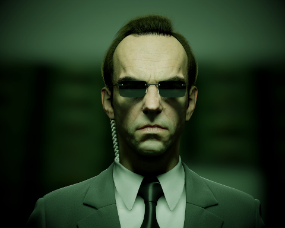
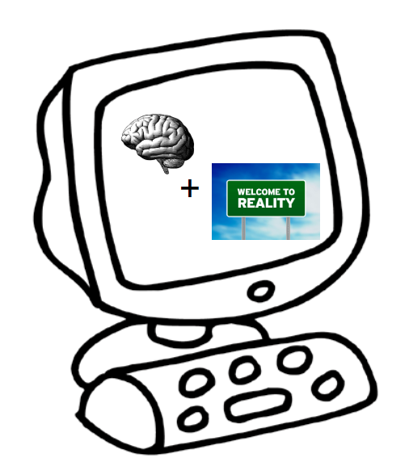
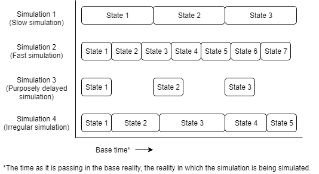
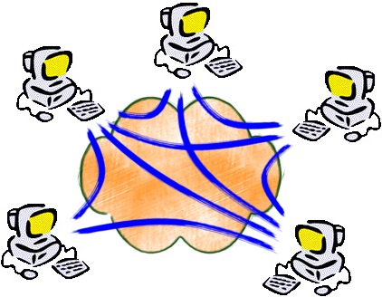
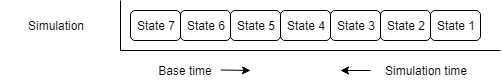

With the recent progress in computing, and more specifically artificial intelligence (mainly neural networks), it is not strange that we see more and more sources[^1] say that it is only a question of time before such a computer program will eventually surpass the capabilities and intelligence of the human brain. A scary thought for one, an interesting thought for another. But if this is indeed a possibility, what will this mean for (human) consciousness and our understanding of it?

This article will explore the consequences for the existence of consciousness in a very specific type of computer simulation: a deterministic simulation.

## Introduction

In a 2016 code conference, Elon Musk famously argues[^2] that there is a high possibility of living inside a computer simulation (the details of this will be explained ahead). If this were to be true, what would this mean for our understanding of consciousness? Assuming that we might actually be living in a computer simulation, would mean we assume that a computer simulation can spawn the consciousness you are experiencing today. But what else does this assumption tell us about the conscious state of mind? This article will pursue that idea, and attempt to explore it to its extremes.

This article does not contain proofs or beliefs about consciousness. Its purpose is to challenge the reader to think about the consequences of believing consciousness is possible in a deterministic simulation.

The structure of this article is as follows. First, we define consciousness as it will be referred to throughout this article. Second, this article contains a brief introduction into the simulation hypothesis, recently popularized by Elon Musk, and the simulation argument as described by philosopher Nick Bostrom. Third, there will be a chapter explaining deterministic systems. Then follow the thought experiments, which will be taken one assumption at a time divided over several chapters ending with the reverse simulation argument, an argument strengthened by both the thought experiments in this article, and the simulation argument of Nick Bostrom. Lastly, this article contains a reflection on the thought experiments, followed by a short conclusion in which the article is summarized.

## Definition of Consciousness

Before we dive into the details of our thought experiment, we first need to align on our definition of consciousness. Due to its inherent subjectiveness, it is difficult (if not impossible) to create an objective definition for consciousness. As a result, different discussions use a different definition, making consciousness a confusing subject to discuss.

Instead of attempting to devise an objective definition for consciousness, this article will challenge you to use your own subjective definition. During the rest of this article, the word consciousness will refer to your conscious experience. By extension, if we are to accept that a computer program can indeed become conscious, we should accept (or try to imagine) the possibility that we currently are in such a simulation ourselves. A perspective also explored in the simulation hypothesis.

## The Simulation Hypothesis

In the somewhat popular simulation hypothesis, it is proposed that we are likely all living inside a simulation. Even though the hypothesis was popularized by Elon Musk, the idea that we might be living in a simulation or illusion has been around since at least a few centuries before Christ[^3]. The simulation argument[^4], which is often referred to when talking about the simulation hypothesis was introduced in 2003 by philosopher Nick Bostrom and is introduced as follows:

> Many works of science fiction as well as some forecasts by serious technologists and futurologists predict that enormous amounts of computing power will be available in the future. Let us suppose for a moment that these predictions are correct. One thing that later generations might do with their super-powerful computers is run detailed simulations of their forebears or of people like their forebears. Because their computers would be so powerful, they could run a great many such simulations. Suppose that these simulated people are conscious (as they would be if the simulations were sufficiently fine-grained and if a certain quite widely accepted position in the philosophy of mind is correct). Then it could be the case that the vast majority of minds like ours do not belong to the original race but rather to people simulated by the advanced descendants of an original race. It is then possible to argue that, if this were the case, we would be rational to think that we are likely among the simulated minds rather than among the original biological ones. Therefore, if we don't think that we are currently living in a computer simulation, we are not entitled to believe that we will have descendants who will run lots of such simulations of their forebears.
> 
> — Nick Bostrom

An interesting train of thought. However, for this idea to work, we have to assume that consciousness is something that can be simulated[^5]. For the sake of this article, we will not only assume this is possible, but we will assume this is possible with our current understanding and implementations of a virtual mind (e.g. neural networks[^6]).

## Deterministic Behaviour

Before we dive into computers that run a conscious simulation, there is one more prerequisite we are going to give this experiment (who would have thought that an article with such a simple title needed so much explanation beforehand? ;) ):

Our simulation will be a completely deterministic program.

In computer science, a deterministic algorithm is an algorithm which, given a particular input, will always produce the same output, with the underlying machine always passing through the same sequence of states[^7].

I think this is a fair prerequisite[^8] to have for our program. Artificial neural network implementations can easily be implemented with a deterministic implementation and for the sake of this article we want to have a purely information based system. We want to prevent “real world magic” to accidentally leak into our system by making use of multiple threads over multiple computer cores for example.

Still from The Matrix (1999), Warner Bros.

Of course, there is still one place where our "base reality"[^9] can leak into our simulation: through the inputs. Even though our simulation might be deterministic, one might argue that base reality is not (still open for debate ;) [^10]). Whether this matters or not, in order to prevent discussions about this, we should also make sure to get our inputs deterministic. This can easily be done by simulating the world as well. Now our “brain” will not only be simulated, but it will be getting inputs from a simulated world as well. Both of these forming the same deterministic system.

A good analogy would be to say that we created a (hopefully kinder) version of mister Smith from the movie "The Matrix": a digital mind, living inside a digital world.

## Let the Fun Begin!

Now we are finally ready to get our thought experiment going. We are going to create a simulation of the human brain. We use a computer to simulate all neuron pathways, circuits and systems. Every particle will be represented. The simulation will be perfect until the last detail of the human brain.

Our simulated brain will receive inputs only from a simulated reality. Both the brain and the reality will be part of the same deterministic system.

Without further ado, I present to you, our simulation:

So, let's assume that a system like that could really result in consciousness. In us. What would this mean?  
Of course, it would mean that we could indeed be living in such a simulation right now, just as stated in Nick Bostrom's paper about the simulation argument. It would only be a matter of tweaking the simulated reality (the inputs) in just the right way to give us the experience we are having today.

But consciousness being able to exist in such a simulated system, opens it up to a whole lot of other questions.

If you were never convinced that we could be living in some sort of "Matrix", or if you believe one of the article’s other prerequisites screwed up the possibility of consciousness being present in the simulation, the rest of this article might not be for you. If on the other hand you are still happy with the possibility of living in a deterministic computer simulation...let us go down the rabbit hole. 

From this moment forward, every chapter will be a new conclusion or assumption we are going to make about our simulation[^11] consciousness. Every chapter will challenge a new boundary about our consciousness. As this is a thought experiment, it is up to you how far you are willing to go with our simulation consciousness. Maybe you will believe the simulation could still be conscious by the end of this article, maybe you change your perspective and believe it was never there to begin with.

Remember, there are no wrong answers. As the cause of consciousness is only a belief after all.

## Free Will

When this article specifically mentioned determinism, a few of you probably already knew where this was going. And yes, the first and most obvious consequence of such a simulation would mean that free will is not real[^12]. Of course, this is subject to your definition of free will[^13]. But no matter how you look at it, in our simulation all thoughts and all decisions could be predicted. We can run the simulation a hundred times over, but if we would start with the same initial state, the simulation would run exactly the same way as it has all the other times[^14].

Even if we were not living in a simulation, the jury is still open about whether or not free will is just an illusion. But if the simulation would actually be conscious and we were living in it, we would at least know that all our thoughts and decisions are the result of a deterministic process.

## The Manipulation of Time

In any artificial mind that only relies on an abstracted logic layer, time would be relative. A slower computer takes more time to process the same amount of calculations than a faster machine would. Additionally, adding artificial delays between every state[^15] transition of our artificial consciousness would also slow its time relative to ours.

If the simulated world is being slowed down/sped up at the same rate as the simulated brain, it should have no effect on the conscious experience whatsoever. We could simulate one second of consciousness in a year’s time. But more interestingly, given a fast enough computer, we could simulate complete lifetimes in what would be only a matter of seconds for us.

The question now is, of course, will all, or any of the simulations as described above, still be conscious? If we no longer accept that they are, our conclusion would be that consciousness is tightly related to the time in base reality, as changing simulation time would cause it to disappear. However, if we still accept that one or more of these simulations are conscious, the relation between base and simulated time becomes a bit more...relative.

## Spaceless

Next, we will explore what effect our spatial dimension has on the consciousness of our simulation. It is easy to imagine running our simulation on a single computer. But as the simulation gets more complicated and more difficult to run on a single computer, it might be desirable to run it on a distributed system. This could be in the form of a supercomputer, which connects the processors of a lot of different machines, or in the form of multiple computers working together over a network, all working together to calculate the next state of our simulation[^16].

In a traditional system, every state is calculated by the same machine, not unlike we imagine our brain does. When imagining a distributed system, we are changing this.

However, if we make the assumption that only the data inside the states of our simulation is necessary for our consciousness, we should conclude that spatial dimensions are not necessarily a factor: The data is still there, and the next state is still being computed.

So what do you think? Could such a distributed system also be conscious? If you think this is a step too far and this is the step where consciousness would break, that means that you believe physical distance plays at least some role in consciousness.

## Delayed Execution and Cloning

But why linger on spatial dimensions alone, if we can make our experiment even more complex. If we combine the assumptions that both spatial dimensions and execution time are flexible when it comes to consciousness (assuming you are still here because you still believe that), we can ask another question: What if we were to discontinue our simulation, save the state to a medium (arguably a very large USB stick), and start the simulation on another machine?

If it hasn’t already, this will probably start to feel unnatural or unrealistic (to us, spatial beings): how do two completely separate states of information connect in forming one conscious experience? Sure, we accept that it doesn't matter for the output we perceive on the outside, but is it still the same consciousness? Still the same uninterrupted experience you could be having today?

Well...who knows? You are free to believe whatever you like. But before you conclude that this leap is the one too big to take, I ask you: should you not have had the exact same reservations for two states separated by time?

Regardless of what you believe at this point, this step also allows for another interesting thought experiment: What would happen if we were to also continue our original simulation again? As our simulation is deterministic, both of them will proceed in exactly the same way. Would we have two identical instances of consciousness?[^17]

## The Reverse Simulation Argument

After adding one more condition to our simulation and combining it with all previous assumptions, there is another interesting thing that can be done: we can run our simulation backwards.

If we implement our simulation in a way that every state does not only provide the information for us to calculate the next, but also allows us to calculate what the previous state would have been, our deterministic simulation can be run in reverse. Instead of defining the beginning of the simulation, we could define how we want the simulation to end and simulate it back to a possible starting state.

Note that concepts like forwards, backwards and reverse are all relative terms. Even though we would define the simulation as going in reverse, it is still a simulation progressing over time. Changes are merely happening differently (e.g. objects falling up, memories disappearing after an event, etc.).

The expected result would be that even though the simulation time would run in reverse, the perceived time of the simulation consciousness does not. As the simulated past (future in base time) can be remembered and the future (past in base time) cannot, the resulting consciousness might not be affected, while from the perspective of the ones running the simulation, it is running in reverse direction.

Apart from this being an interesting (and logical) next step to take in this thought experiment, this scenario also fits well with the reverse ancestor simulations that Nick Bostrom is referring to in his simulation argument. For what better way to find out what your ancestors were up to, than to start with your current state and simulate time backwards in order to find out. This would also be a good argument for running a lot of simulations, as the butterfly effect[^18] will likely cause even the most precise starting states to show larger and larger deviations[^19] as the simulation progresses further back in time.

Does a simulation like this still have the potential to be conscious? What do you think?

If you believe there is a chance we are living in a simulation[^20], you should also consider the chance that your conscious time is actually running backwards to the base world's time. If this is the case, let us just hope this simulation started the moment you died of old age[^21].

## Conclusion

The assumption that we could all be living in a (deterministic) simulation, does have consequences for our understanding of consciousness.

If our current experience is indeed one that is resulting from such a simulation, the following should be considered:

Firstly, as the simulation is deterministic, there are no deviations on the way the simulation will play out. Based on its definition, one could say there is no actual free will. Secondly, it is possible that simulation time could be manipulated relative to the base reality the simulation is running in. Thirdly, the simulation might not have to run in the same physical configuration throughout its lifetime, allowing for pausing, moving and copying of the simulation. Finally, we should consider that the simulation might be running backwards. If this is the case, it would mean that consciousness can do the same, as conscious experience would be connected to simulation time.

## Reflection

That was quite the thought experiment, wasn’t it? We went from a seemingly straightforward idea to something we would not even find in the strangest of science fiction.

Did we break the simulation consciousness somewhere along this thought experiment (did we make an assumption too many), did we just need these over the top (reductio ad absurdum[^22]) scenarios to figure out that a deterministic simulation has no chance of being conscious whatsoever, or does consciousness work in stranger ways than we initially dared to imagine?

Whatever the case, it is up to you what you believe.

[^1]: Just to name a few: [https://papers.ssrn.com/sol3/papers.cfm?abstract\_id=3173876](https://papers.ssrn.com/sol3/papers.cfm?abstract_id=3173876) [https://www.alibabacloud.com/blog/man-vs-ai--six-fields-where-artificial-intelligence-are-surpassing-human-intelligence\_584189](https://www.alibabacloud.com/blog/man-vs-ai--six-fields-where-artificial-intelligence-are-surpassing-human-intelligence_584189) [https://arxiv.org/abs/1705.08807](https://arxiv.org/abs/1705.08807)
[^2]: Watch Elon Musk's argument here: [https://www.youtube.com/watch?v=2KK\_kzrJPS8](https://www.youtube.com/watch?v=2KK_kzrJPS8)
[^3]: [https://io9.gizmodo.com/youre-living-in-a-computer-simulation-and-math-proves-5799396](https://io9.gizmodo.com/youre-living-in-a-computer-simulation-and-math-proves-5799396)
[^4]: [https://www.simulation-argument.com/simulation.html](https://www.simulation-argument.com/simulation.html)
[^5]: Assumptions are described in Nick's paper
[^6]: [https://en.wikipedia.org/wiki/Artificial\_neural\_network](https://en.wikipedia.org/wiki/Artificial_neural_network)
[^7]: [https://en.wikipedia.org/wiki/Deterministic\_simulation](https://en.wikipedia.org/wiki/Deterministic_simulation)
[^8]: This prerequisite might actually be somewhat of an illusion: it does not mean anything for the simulation itself as all simulations are deterministic if only run once (or run multiple times with the exact state of the universe being the same as we start (According to the belief of determinism)). It is highlighted in this article as it prevents discussions from getting sidetracked as well as filtering out the possibility of "unknown physical forces" ("real world magic") causing consciousness.
[^9]: Going forward, "base reality" is defined as the "real world": The reality that is not simulated by technology, in which our simulation is running.
[^10]: See Determinism: [https://en.wikipedia.org/wiki/Determinism](https://en.wikipedia.org/wiki/Determinism)
[^11]: Even though I use terms like “simulated brain” and “simulated reality” I purposely refer to the conscious experience as “simulation consciousness” rather than “simulated consciousness” as the purpose of this article is to think under the pretense that the conscious experience that results from the simulated brain is, in fact, real.
[^12]: Even though determinism makes this fact more obvious, this could also be the case without determinism: Any simulation that would run independent of "real world magic" would be a simulation without free will.
[^13]: E.g. Compatibilism states that free will is compatible with determinism. See [https://en.wikipedia.org/wiki/Free\_will#Compatibilism](https://en.wikipedia.org/wiki/Free_will#Compatibilism)
[^14]: Computer scientists might mumble something about floating point rounding errors on different machines, but we all know that is beside the point here ;)
[^15]: For the computer scientists among you: keep in mind that state does not necessarily refer to a complete new state of the entire simulated brain. Depending on the implementation, a new state could occur after changing as much as a single value in a simulated neuron.
[^16]: Imagine that measures will be taken to keep the simulation deterministic.
[^17]: For more about this step of the thought experiment, check out the Ship of Theseus: [https://en.wikipedia.org/wiki/Ship\_of\_Theseus](https://en.wikipedia.org/wiki/Ship_of_Theseus)
[^18]: [https://en.wikipedia.org/wiki/Butterfly\_effect](https://en.wikipedia.org/wiki/Butterfly_effect)
[^19]: Note that these are deviations in starting state or universal constants programmed into the simulation. Not deviations between two simulations with the same constants and starting states, as we are still discussing a deterministic simulation.
[^20]: For this step it does not even matter if it is a deterministic simulation or not.
[^21]: As the simulation started when you died of old age, it would guarantee that you are to live to old age, as your future experience has already happened (in base time).
[^22]: [https://en.wikipedia.org/wiki/Reductio\_ad\_absurdum](https://en.wikipedia.org/wiki/Reductio_ad_absurdum)
