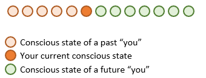
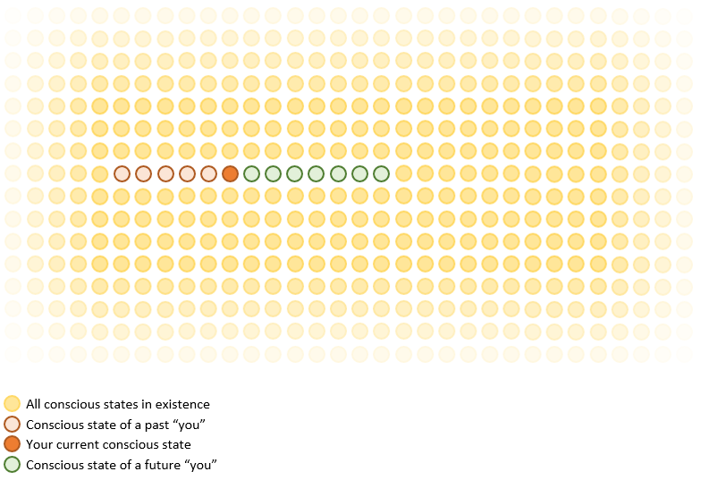

## Introduction

Since I can remember, I have found karma to be a charming idea: people that do bad things, end up getting back bad things and people who do good things eventually get just as much goodness in return.

Even though I am not the superstitious type, deep down it is something I (want to) believe.

In the western world, karma is a concept that is commonly thought of when something unexpectedly good or bad happens. Take the example of playing a game: karma is mentioned when someone who purposely opposed you, gets some bad luck the next turn. And we like it more when kind people take the win (but of course not as much as we like to win ourselves ;) )

And this is what I used to think all there is to karma. Act like a jerk, and people won't do good things for you. Be a kind person, and good things come to you because people feel like you deserve it.

Then of course there is still the subconscious vibe you give off to the people around you, but the point remains the same: karma is a people thing.

But could karma also go deeper than that? Could karma be more like the religious interpretations? Something not there because of people, but something that is embedded in existence itself?

Even though it sounds like a beautiful notion, it is also a complex one: you make a choice, and later the universe alters your fate in order to either reward you or to punish you. Does this mean there are universal definitions of what is good and what is bad? And does that mean there is actually a medium in which a score is kept in the form of "karma-points"?

Well, in this article I will make a case for just that...sort of. But probably a bit differently than you are expecting right now.

## Definition

Before we dive into things, I want to clarify that this article will not make a case for any specific interpretation of (the law of) karma. It will merely refer to the concept of cause and effect we refer to in everyday life. The notion of “what goes around, comes around” as it were.

## You

Of course, this article wouldn't be mine if I didn't at least involve something complex, vague and hard to grasp. And as this article is no different, I will involve...you! Yes you!

The concept of you is a very difficult one indeed. You might stop reading this article for a bit to disagree. You're feeling quite you, don't you? At this point maybe even more so as you are focusing your thoughts on your “you-ness”.

But were you “you” yesterday? Were you “you” last week? And how about 10 years ago?

Well, of course you were you. You remember being you in the past. And you plan for you in the future. Yet, there is a case to be made that you were, and will be, not you.

Of course, “you” is just a definition we assigned to the experience we have as humans. An experience hardwired to ourselves. Probably because an understanding of “you” is useful for “your” survival. You can learn from the past, and influence the “you” from the future.

But just because we assigned the word “you” to your feeling of “you-ness” does not mean it carries any value outside your scope of observation and experience.

The question of identity is an entire philosophical discussion of its own. You could argue about physical identity or even ponder the definition of identity itself. But instead of these topics, I want to challenge you to think about your own perspective of “you”.

Take a moment to look back a few years, to a younger you. From your perspective, this younger version is still you. But besides this feeling and the fact that most people would argue you and your younger self to be the same person, how do you actually feel about that yourself?

Depending on how far back you go, you probably have little in common with the person you were.

You used to be a child and have very different perceptions and thoughts about the world than you do now. In many ways, you are probably more similar to others of your age group than you were to yourself back then.

The only real additional advantage you have over understanding your younger self rather than someone you have a lot in common with, is your ability to actually remember experiences (and being conscious) from their point of view.

Having memories of your younger self could by itself be an argument to differentiate you from other people. However, this would only be one directional. It does give you a connection to your past. But does not connect you to any future self.

And as our actions are only able to influence the future, the connection to your future self is what matters most for this article. You are willing to make sacrifices for the benefit of that future person you will become. A person you do not yet have any connection with at all.

## A State of Consciousness

And let’s say we accept the idea that we are no longer the person we were, and will be a different person in the future. What will happen if we explore this idea further? Surely we were a different person 10 years ago. But how about 5 years? A single year? A month?

Accepting you were a different person 10 years ago has to mean that somewhere along the line, you changed from one person into another.

The philosophy of flow and change are deep topics of themselves. Of course, these discussions will depend heavily on definition: What is it to be you? What does it mean to be a different person?

As this is an article about your experience, you are free to define this for yourself. Maybe you define yourself to be the person you are this day. Maybe you continue this train of thought and decide you are only the person you are at this very moment. A single state in time.

No matter how you define your moment of being, it is a way to separate your past, present and future. Instead of seeing yourself as a person living from birth to death and having a single large consciousness over your lifetime, you can interpret yourself as a conscious being living only in a moment, a conscious state. The only thing connecting future and past conscious states to your feeling of “you”, is that those states are also conscious of your past memories and imagination of the future, creating the illusion of the continued consciousness you experience.

> *You cannot suffer the past or future because they do not exist. What you are suffering is your memory and your imagination.*
> 
> — Sadhguru

Besides the illusion of these connections there is nothing making one of these states more “you” than any other state would be.

The image below is a simple representation of this idea: You as a collection of conscious states.

(The above representation is linear to make the argument easier to understand. Note that the concept of time is not actually needed for this abstraction. For the sake of simplicity, I will not go into that in this article.)

## Others

Now that we have covered “you”, it is time to cover another important aspect of karma: others. After all, without others to influence, there wouldn’t be any good or bad actions to begin with and thus no karma to speak of.

With the previous chapters in mind, discussing others is not going to be a very large leap. You probably define others as “other people”. But as people experience multiple conscious states, how is a conscious state of another person really that different from a conscious state that used to be you?

Imagine all conscious states that ever existed and will ever exist mapped in a single landscape. A small fraction will be a conscious state you experienced in your past. Another fraction will be the states you will experience as your future. But as even your own conscious states are not actually connected by anything more than memory and imagination, what makes them different from conscious states of other people?

While this thought might weaken the sense of “self” it can also be interpreted as a strengthening of the sense of “all”. If the connection you have to your past and future are indeed not as special as we feel they are (and in nature/physics, anything rarely is), you could also argue that the connection we have to everything else might just be as special as that intuitive connection to ourselves we experience. 

What if the conscious states you experienced as a child, a different person, are just as different to your current conscious state as your current conscious state is to all others? There might be multiple conscious “experiences”, but there might only be a single consciousness.

> The lives of others might just be a part of your life that you do not remember nor imagine.

## Karma

By now, most of you will probably have a pretty good idea of where I am going with this article. The case I am making is quite easy to summarize; instead of making a separation on people, I am making a separation based on conscious states.

Granted, taking this leap does take some imagination. But if you can accept the idea, it opens you up to a whole new perspective. Instead of isolated experiences of a single person, you are suddenly able to remember the experiences of different conscious states. And maybe more importantly, it is a lot easier to accept the existence of conscious states that do not originate from the person you are.

Being able to remember being conscious when you were younger is a great testament to the consciousness in others. If the probability of a consciousness in a future version of yourself makes you want to take care of yourself and even sacrifice current pleasures for the future, why does the same not apply to others?

If the conscious experience is indeed the same for all. Does it actually make sense to discriminate between them just because one belongs to your future “you” and another belongs to another person? Would it not make more sense to take care of other people like you would take care of your future self? Sure, you won't be able to remember it, but the other person, or rather “you” might appreciate it as much, if not more than your future self would.

You will probably not be getting some bad dice rolls in a game because you are acting like a jerk. But in the end, you might just experience that energy while sitting on the opposite side of that table.

Karma might not be some unexplainable higher force of nature nor a point system kept in some cosmic ledger. But karma is all actions we take (good or bad), which are influencing and experienced by others. And even if you think that an action does not influence “you”, it actually might. Just not the “you” you are now.

Hopefully you don’t need this extensive argument in order to value all life. But I would say this argument does not only try to sell karma. It makes a case for a beautiful and balanced universe. Eventually, you will experience all kindness you put out into that universe. If it is not in this life, it will be in another.

## Personal Thoughts

Personally, I find this thought to be a beautiful one. Not only does it give an explanation for a topic like karma, it also makes all conscious beings responsible for the overall experience of existence. Our actions actually do change the average experience of consciousness. Even if it’s just by a tiny bit.

It is testament to yet another balance like so many that can be found in nature. We are all the judge, jury and executioner of all of existence. If we judge something to be bad, it is also the execution of our own actions that can make a difference.
