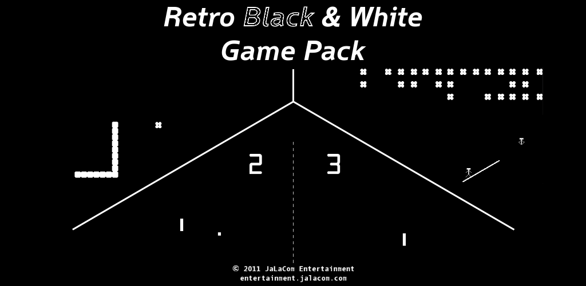

I wrote it to try out XNA, Microsoft's game framework, and to get something into the Windows Phone marketplace. It's three simple games in one app: Bouncy, a pong-like game against your phone or a friend; Snaily, based on snake; and Plankmen, based on the old seesaw game.

It went live on 1 September 2011 for $1, under my publisher name JaLaCom. A free trial followed in November.

I was working with Java for another project at the time and wanted to learn Android, so I ported it. That meant writing a small game engine to replace XNA and supporting every screen resolution. The Android version came out on 27 February 2012.

Neither version is available anymore. The trailer is still on YouTube.

## Media

- Video: [trailer](https://www.youtube.com/watch?v=KAh23zU9O4g)
