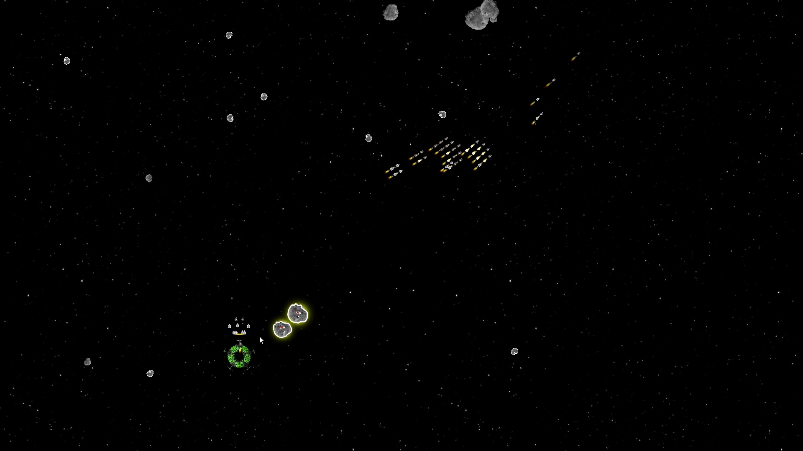
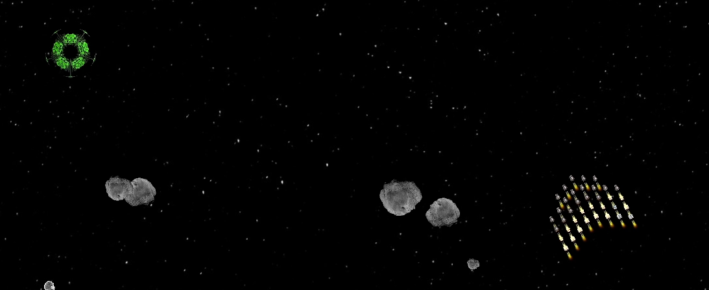
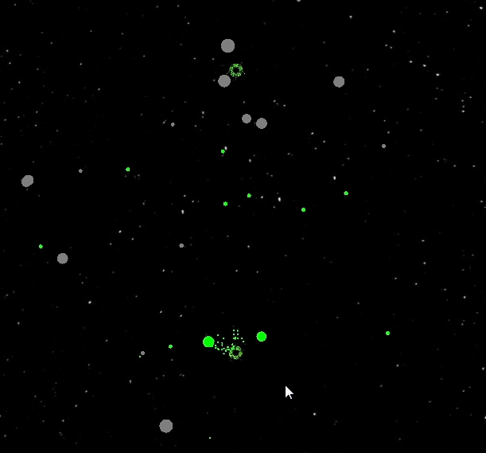
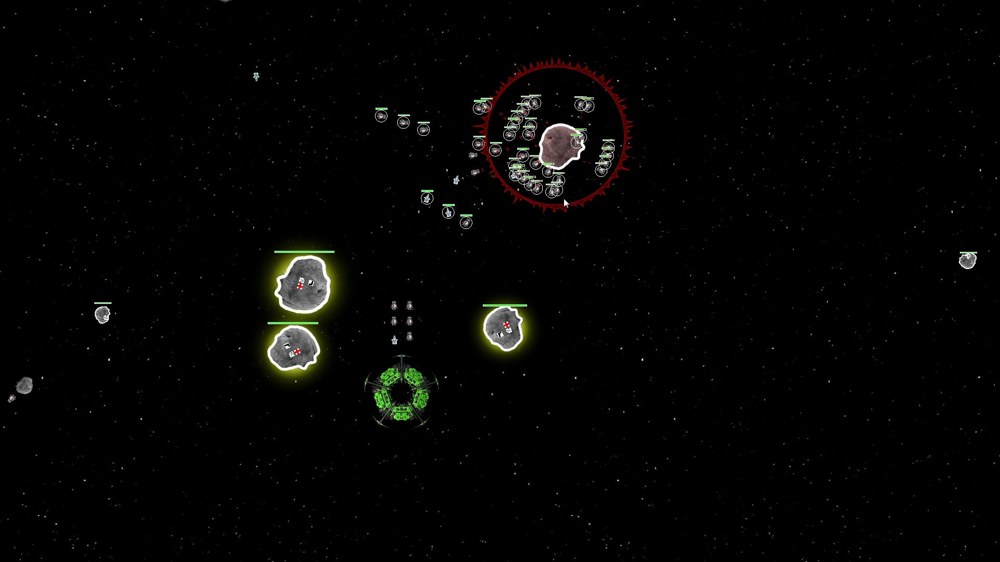
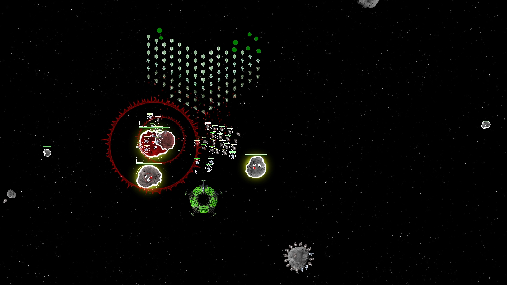

In 2014 I started a space strategy game based on rock paper scissors. I wanted to build it from almost nothing: Java, which I didn't use at work, and my own networking, physics and collision detection.

You send ships through a portal, one at a time. Rock beats scissors, scissors beat paper, paper beats rock. Enemy ships stay blue until you fire on them, so you find out what you're up against the hard way. Meteors can be occupied and turned into a slow, heavy fourth unit.

In 2018 I dug it up again. The code held up better than I expected, so I kept going and released 13 versions in ten months, starting 7 June 2018. Three colleagues play-tested it in November 2018. In February 2019 I ran 10,000 ships in formation to see if it would hold. It did.

Version 0.13 came out on 4 April 2019. It's a working prototype, and that's where it stands.

## Under the hood

<table>
  <tbody>
    <tr><th scope="row">Language</th><td>Java, with Slick2D and Guava</td></tr>
    <tr><th scope="row">Networking</th><td>My own client/server protocol: TCP for the lobby, UDP in the game. Every client runs the same deterministic simulation from the same commands.</td></tr>
    <tr><th scope="row">Simulation</th><td>My own fixed-point math and physics</td></tr>
    <tr><th scope="row">Collision detection</th><td>My own quadtree</td></tr>
  </tbody>
</table>

## Media

Screenshots from a multiplayer test session, November 2018.

- Video: [version 0.13 gameplay](https://www.youtube.com/watch?v=9Q2tKguidNY), April 2019
- Video: [10,000 ships in formation](https://www.youtube.com/watch?v=Cz1bwrgLFDs), February 2019
